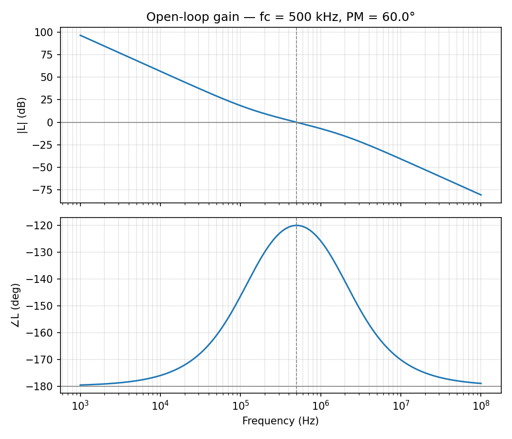
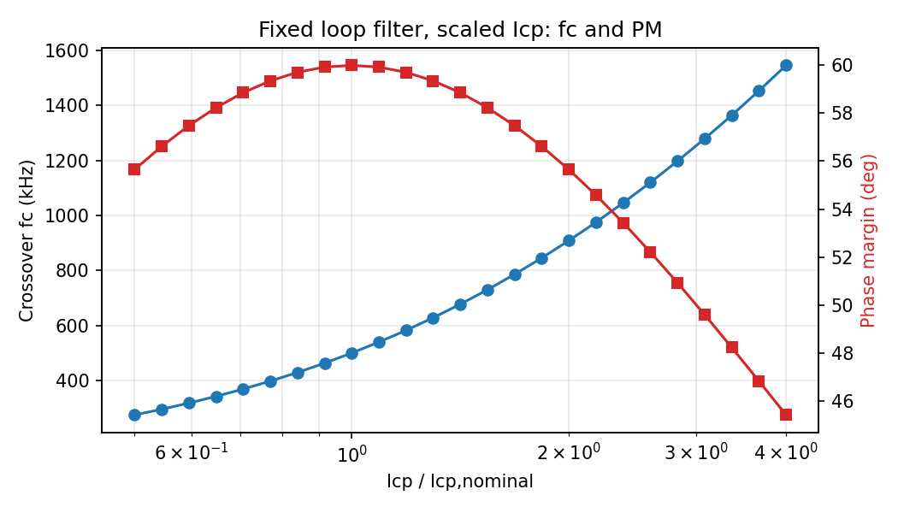

# fracn-pll-model

A Python phase-noise and spur model of a fractional-N charge-pump PLL, built from first principles
and validated against hand analysis. Open-source data only.

> **Status:** integer-N linear loop model complete — loop gain, phase margin, loop-filter design (all tests passing).
> Next: per-source noise transfer functions and integrated jitter.

## Target specification

| Parameter | Value | Note |
|---|---|---|
| Reference frequency | 40 MHz | |
| Output frequency | 6 GHz | 5–7 GHz LO range |
| Divider ratio N | 150 | integer for now; fractional from week 6 |
| Loop bandwidth (crossover fc) | 500 kHz | |
| Phase margin | 60° | |
| VCO gain Kvco | 100 MHz/V | |
| Charge-pump current Icp | 100 µA | |
| Integrated jitter | < 100 fs rms | system target (from week 2) |
| Reference spur | < −70 dBc | (from week 4) |
| Fractional spur | < −55 dBc | (from week 8) |

## Design method

The loop filter is a series R–C1 branch shunted by C2. C1 and R give the integrator and the stabilizing zero; C2 smooths the charge-pump current pulses on V<sub>ctrl</sub> to suppress the reference spur, at the cost of a third pole. The phase-domain loop gain is

$$L(s) = K\,\frac{1+s/\omega_z}{s^2\,(1+s/\omega_{p3})},\qquad K=\frac{I_{cp}K_{vco}}{2\pi N\,(C_1+C_2)},\qquad \omega_z=\frac{1}{RC_1},\qquad \omega_{p3}=\frac{C_1+C_2}{R\,C_1C_2}$$

**Phase margin.** The two integrators contribute −180°, so $PM(\omega_c) = \arctan(\omega_c/\omega_z) - \arctan(\omega_c/\omega_{p3})$. Setting $dPM/d\omega_c = 0$ gives $\omega_c = \sqrt{\omega_z\,\omega_{p3}}$: crossover belongs at the geometric mean of the zero and the pole. With $b = \omega_{p3}/\omega_z = 1 + C_1/C_2$,

$$PM_{max} = \arctan\frac{\sqrt{b}-1/\sqrt{b}}{2}\quad\Longrightarrow\quad \sqrt{b} = \tan PM + \sec PM$$

so the phase-margin target alone fixes the capacitor ratio: 60° → b ≈ 13.9, C1/C2 ≈ 12.9.

**Loop gain.** Forcing $|L(j\omega_c)| = 1$ at that point gives the exact condition $K = \omega_c^2/\sqrt{b}$. The usual approximation $\omega_z \ll \omega_c \ll \omega_{p3}$ (where $|L| \approx K/(\omega_z\omega_c)$) gives the same answer, because $(1+b)/(1+1/b) = b$ exactly.

**Spec → components.** `design_filter()` inverts these relations: PM → b; f<sub>c</sub> → ω<sub>z</sub>, ω<sub>p3</sub>; K → C1 + C2; b → C1, C2; ω<sub>z</sub> → R. For the nominal spec: **R = 50.8 kΩ, C1 = 23.4 pF, C2 = 1.81 pF** (f<sub>z</sub> = 134 kHz, f<sub>p3</sub> = 1.87 MHz). `tests/test_loop.py` checks the round trip: the forward model returns f<sub>c</sub> = 500 kHz and PM = 60.0°.

**Trade-off.** More phase margin needs a larger b: a bigger C1 (area) and a relatively smaller C2, which pushes ω<sub>p3</sub> up and weakens ripple filtering at f<sub>ref</sub>. Phase margin is bought with reference-spur attenuation; 55–65° is the usual compromise.

## Results

### Open-loop gain at the nominal design


### What happens if Icp changes with the filter fixed?


Doubling I<sub>cp</sub> raises |L| by 6 dB at every frequency, so crossover moves to wherever the curve falls back to 0 dB — and how far depends on the local slope. At −20 dB/dec (ω<sub>z</sub> ≪ ω<sub>c</sub> ≪ ω<sub>p3</sub>) f<sub>c</sub> would double; at −40 dB/dec (below ω<sub>z</sub>) it would move only √2×. Here f<sub>c</sub> sits only √b ≈ 3.7× from each corner, so the local slope is ≈ −22.7 dB/dec and 2× I<sub>cp</sub> gives **f<sub>c</sub> × 1.82 (500 → 909 kHz)**. Because the design places f<sub>c</sub> at the phase-margin peak, moving crossover in *either* direction lowers PM: **60° → 55.6° at 2× I<sub>cp</sub>**.

## Repository layout

```
pllmodel/loop.py      linear loop model: loop gain, closed loop, phase margin, loop-filter design
tests/test_loop.py    analytic checks (oracle values, round trip, PM optimum)
scripts/bode.py       Bode plot at the nominal design
scripts/sweep_icp.py  fc and PM vs Icp with a fixed filter
```

## Running it

```bash
pip install -r requirements.txt
pytest -v
python scripts/bode.py
python scripts/sweep_icp.py
```
